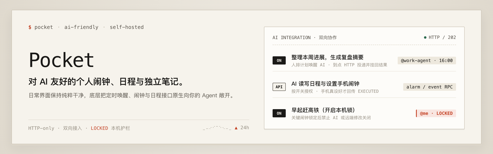

<div align="center">
  
  <br><br>
  <p>
    <a href="https://github.com/12bitsD/pocket/actions/workflows/test.yml"></a>
    <a href="https://github.com/12bitsD/pocket/releases"></a>
    
    
  </p>
  <p>
    <a href="#为什么做-pocket">为什么做</a> ·
    <a href="#怎么接入-ai">怎么接入 AI</a> ·
    <a href="#界面一览">界面一览</a> ·
    <a href="#两个独立应用">产品构成</a> ·
    <a href="#下载与部署">下载与部署</a>
  </p>
</div>

---

## 为什么做 Pocket

现在市面上大部分闹钟、日历和待办软件，对 AI 其实都不太友好——数据关在各自的孤岛里，很难干净、稳定地接进自己的 Agent。

翻了一圈现有的开源项目，也没有找到顺手合适的方案，最后下定决心干脆自己烧 token 从头把这一套开发出来。

想法很朴素：**不在日常工具里硬塞一个难用的 AI 聊天窗口**，而是先把每天真要用的闹钟、日程、待办（以及后面独立的笔记）做干净，同时从底层把接口原生向你自己的 AI 敞开。

---

## 怎么接入 AI

Pocket 围绕「人和自己的 Agent 怎么配合管时间」设计了 4 个核心能力：

### 1. 在 Todo 里直接 `@` 你的 Agent，到点自动唤醒它干活
不用把“个人闹钟”和“AI 定时任务”拆成两套系统。在同一行待办里：
- 选 **`@me 07:30`** → 同步到手机系统闹钟准点响铃（Direct Boot 未解锁重启可恢复、断网本地即设、锁屏全屏唤醒与 10 分钟贪睡）；
- 选 **`@work-agent 16:00`** → 到点由私有云直接把这条内容通过 HTTP 发给你的 Agent 去跑，**不要求手机亮屏在线**，跑完的结果摘要直接挂回原待办下面。

### 2. AI 也能反过来帮你排日程、设真机闹钟
给你的 Agent 配一把受限密钥，它就能直接调接口查你的空档、建日程、加待办或设手机闹钟。状态完全诚实——只有手机真正写进系统闹钟后才返回 `EXECUTED`，手机离线排队或权限缺失失败都会如实告知，不报假喜。

### 3. 给关键事项留“人类护栏”：本机锁与按需授权
- **本机锁（`LOCKED`）**：像早起赶高铁这种不能出岔子的闹钟，在手机上打开本机锁后，AI 和远端一律不能修改或关闭；手机离线期间修改本机锁事项也会在重连后优先覆盖云端。
- **按开关细粒度授权**：哪个 Agent 只允许读日程、哪个允许改待办、或者（后续）只允许读哪几篇笔记，全部单独开关控制，随时可撤回。

### 4. 纯 HTTP + CLI 胶水层，不绑死任何 AI 框架
不管你用的是自建 Agent、Claude / Codex 脚本还是自动化工作流，只要能收发普通 HTTP JSON 请求或直接调用 `pocket` CLI，填一个地址和密钥就能连进来。

---

## 界面一览

<p align="center">
  
</p>

| 栏位 | 说明 |
| --- | --- |
| **`[d]` 今日日程** | 只显示今天当天的安排（下一场主角卡 + 今日其余场次 + 时间重叠提醒），不被跨天事项干扰。 |
| **`[m]` 月历** | 7 列等宽月历，区分强提醒响铃与普通日程，点选任意日期查看或新建。 |
| **`[t]` Todo** | 一套输入同时管普通待办、`@me` 手机闹钟与 `@agent` 定时任务；单次事项打勾归档，周期任务用开关启停并支持跳过下一次。 |

支持浅色暖亚麻纸与夜间深炭纸两种主题（按键 `b` 切换），手机端内置真机 4 项响铃权限一键自检跳转卡。

---

## 两个独立应用

使用场景不同的工具不硬塞进一个臃肿软件里。Pocket 拆成两个完全独立的应用，共用同一套个人私有云端：

| 应用 | 定位 | 状态 |
| --- | --- | --- |
| **Pocket Calendar** | 日程、月历、手机闹钟与 Agent 定时任务合一 | 已交付（Web 独立包 + Android 正式 APK · `calendar-v*`） |
| **Pocket Notes** | 独立笔记应用，支持按篇勾选授权给指定 Agent 读取 | 规划中（独立安装包与入口 · `notes-v*`） |

---

## 下载与部署

### 客户端（Android APK & Web）
前往 **[GitHub Releases](https://github.com/12bitsD/pocket/releases)** 下载对应应用的独立发布产物（`calendar-v*` 同时提供 `pocket-calendar-<ver>.apk` 安卓安装包与 `calendar-<ver>.zip` 独立网页包）。

本地开发预览与构建：

```sh
npm install
npm --workspace @pocket/calendar run dev     # 本地启动 Vite 预览（未连云端时自动进入 DEMO 演示态）
npm run build                                # 构建网页端静态包 apps/calendar/dist/
bash scripts/build-android-apk.sh 0.2.0      # 构建并单测签名版 Android APK -> dist/pocket-calendar-0.2.0.apk
```

### 私有云端与 CLI
后端服务与命令行工具统一放在 [`cloud/`](cloud) 目录：

```sh
cp cloud/.env.example cloud/.env
# 启动前请先将 cloud/.env 中的 POCKET_BOOTSTRAP_KEY 与 POCKET_SECRET_KEY 替换为真实密钥
docker compose -f cloud/docker-compose.yml up -d

# 使用 CLI 管理配对码、日程、Todo、触发调试与同步监听
cd cloud && uv run pocket --help
```

---

## 目录结构

```text
pocket/
├── apps/
│   ├── calendar/       独立应用 1：Web 模块化界面 + Capacitor/Kotlin 安卓真机响铃容器
│   └── notes/          独立应用 2：独立笔记（规划中）
├── cloud/              私有云端服务（FastAPI + PostgreSQL）与 pocket CLI
├── packages/           共享定时契约与纸墨终端样式（Paper Teletype）
├── docs/               架构设计、设计标准与发布约定
└── scripts/            全链路验证、静态审计与 Web/APK Release 打包脚本
```

需要了解完整开发路线与底层设计细节，可查看 [`docs/development-plan.md`](docs/development-plan.md)、[`docs/architecture.md`](docs/architecture.md)、[`docs/releases.md`](docs/releases.md) 与 [`docs/design-standard.md`](docs/design-standard.md)。
